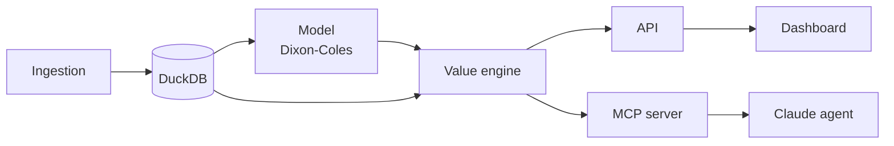

# Architecture

Data flows one way: raw data is ingested, stored, modelled, turned into value bets and then consumed by the API, the agent and the dashboard.

## Components

| Component | Package | Role |
|---|---|---|
| Ingestion | `vba.data` | Fetches, cleans and loads matches and odds. |
| DuckDB | `data/` | Single local database file with matches, odds and model outputs. |
| Model | `vba.model` | Fits Dixon-Coles team strengths and predicts outcome probabilities. |
| Value engine | `vba.betting` | Converts odds to probabilities, computes edge, sizes stakes and runs backtests. |
| API | `vba.api` | HTTP endpoints for predictions and value bets. |
| MCP server | `vba.mcp_server` | Exposes the model and betting functions as tools. |
| Claude agent | `vba.agent` | Uses the MCP tools to reason about matches and bets. |
| Dashboard | (planned) | React/TypeScript front end that reads from the API. |
