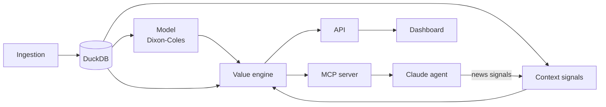

# Architecture

Data flows one way: raw data is ingested, stored, modelled, combined with context signals, turned into value bets and then consumed by the API, the agent and the dashboard.

## Components

| Component | Package | Role |
|---|---|---|
| Ingestion | `vba.data` | Fetches, cleans and loads matches, odds and, from a structured API, injuries, suspensions and line-ups. |
| DuckDB | `data/` | Single local database file with matches, odds, signals, bets and model outputs. |
| Model | `vba.model` | Fits Dixon-Coles team strengths and predicts outcome probabilities. |
| Context signals | `vba.signals` (planned) | Produces structured signals in three levels (see below). |
| Value engine | `vba.betting` | Converts odds to probabilities, computes edge, sizes stakes, runs backtests and logs bets with taken and closing odds. |
| API | `vba.api` | HTTP endpoints for predictions and value bets. |
| MCP server | `vba.mcp_server` | Exposes the model, signals and betting functions as tools. |
| Claude agent | `vba.agent` | Uses the MCP tools to reason about matches and bets, and turns news into level 3 signals. |
| Dashboard | (planned) | React/TypeScript front end that reads from the API. |

## Context signals

A signal is a structured record that says something the statistical model cannot see.

| Level | Phase | Source | Validation |
|---|---|---|---|
| 1 | 3 | Computed from match data: card-accumulation suspensions (including picking up a fifth yellow on purpose), motivation from the league table, rotation risk (rest days, important upcoming match). | Historical backtest. |
| 2 | 2 | Injuries, suspensions and line-ups from a structured API (source to be decided). | Historical backtest where the source has history. |
| 3 | 4 | News read by the agent and converted to signals with player, status, confidence and source. | Forward CLV only. |

Level 3 signals never change probabilities automatically. The agent flags markets to review and explains why, and the user decides.

Every signal and every bet is stored with the odds taken and the closing odds, so closing line value (CLV) can be measured.
